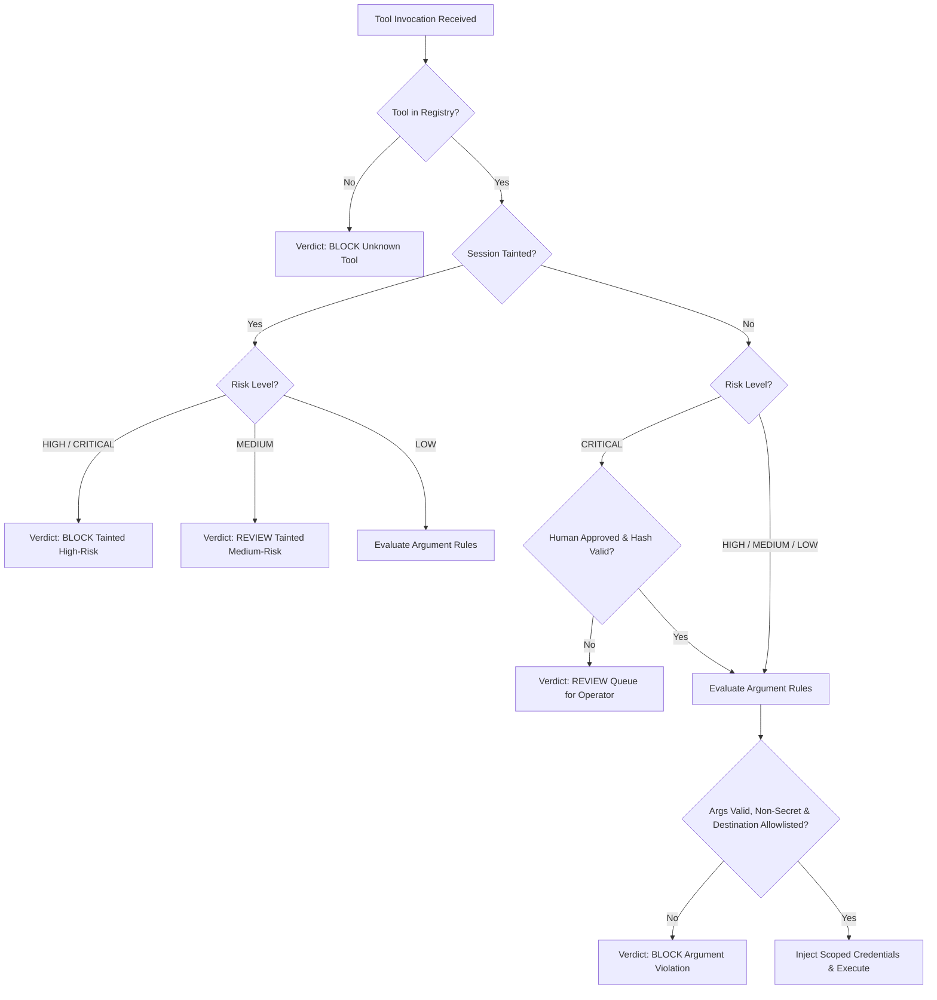

# AGENTGUARD ARCHITECTURE WHITEPAPER
## Tier 0 Security Foundation: Technical Architecture, Threat Model, and Operational Specification

**Document Version:** 2.0.0-PROD-AUDIT  
**Auditor / Author:** Staff Security Architect & Technical Due Diligence Reviewer  
**Classification:** Technical / Architectural Due Diligence Review  
**Target Release:** Tier 0 Minimum Viable Product (MVP)  
**Target Team Size:** 4 Software & Security Engineers  
**Status:** Approved for Implementation — Grounded Production Baseline  

---

## 1. Executive Summary & Engineering Context

Autonomous Large Language Model (LLM) agents are increasingly entrusted with operational capabilities: executing database queries, orchestrating external REST APIs, dispatching enterprise communications, and ingesting unstructured multi-source documentation. However, current industry deployments routinely conflate probabilistic natural language reasoning with execution authorization. 

When an agent ingests untrusted third-party content (such as PDFs, research papers, web scrapes, or customer tickets), that content enters the model's context window alongside trusted system directives. This structural design vulnerability—commonly categorized as **Indirect Prompt Injection (IPI)**—allows an external adversary to hijack model control flow, tricking the LLM into invoking sensitive operational tools, exfiltrating confidential data, or bypassing intended business constraints.

```
       PROBABILISTIC REASONING != EXECUTION AUTHORIZATION
┌────────────────────────┐             ┌────────────────────────┐
│  Untrusted Input Data  │ ──(Taint)─> │   LLM Reasoning Core   │
│ (PDFs, Web, User Text) │             │ (Probabilistic / Weak) │
└────────────────────────┘             └───────────┬────────────┘
                                                   │ Proposes Tool Call
                                                   ▼
                                       ┌────────────────────────┐
                                       │ AgentGuard Tool Gateway│
                                       │ (Deterministic Policy) │
                                       └───────────┬────────────┘
                                                   │ Enforces Authorization
                                                   ▼
                                       ┌────────────────────────┐
                                       │ Downstream Tool / APIs │
                                       │ (Isolated Execution)   │
                                       └────────────────────────┘
```

The original AgentGuard architecture specification proposed an overly ambitious, theoretical 100-point 3-tier matrix relying on unproven or unnecessary frontier technologies (Fully Homomorphic Encryption, Quantum Key Distribution, ZK-SNARK proofs, eBPF network hooks, gVisor micro-sandboxing, and autonomous multi-agent debate). Such proposals are unmaintainable, untestable, and impossible for an agile engineering team of four to ship and defend in production.

This whitepaper supersedes all prior theoretical iterations. It establishes **AgentGuard Tier 0: The Security Foundation**. Tier 0 discards the theoretical wishlist in favor of an air-tight, deterministic execution barrier grounded in the core axiom: **Information is not authorization.** 

The system treats all external documents as untrusted input, strips LLM agents of direct network and credential access, forces every proposed tool invocation through an out-of-process **Mandatory Tool Gateway**, applies deterministic policy rules (via dynamic Open Policy Agent / structured policies), bounds data lifecycles via cryptographic shredding, and requires tamper-evident, hash-bound human-in-the-loop verification for high-risk operations.

---

## 2. Scope Reduction: The Tier 0 Minimum Viable Product

### 2.1 Abandonment of Theoretical Constructs
To build a system that can be reliably deployed, monitored, and audited within an enterprise environment, all non-essential and research-stage technologies have been explicitly excised from the architecture.

| Excised Technology | Initial Justification | Due Diligence Engineering Reality & Rationale for Removal |
| :--- | :--- | :--- |
| **Fully Homomorphic Encryption (FHE)** | "Compute on encrypted prompts without decryption" | Adds 4–6 orders of magnitude computational latency overhead. Completely incompatible with real-time interactive agent pipelines. Standard TLS 1.3 in-transit and AES-256-GCM at-rest provide standard, defensible security. |
| **Quantum Key Distribution (QKD)** | "Future-proof cryptographic transport" | Requires dedicated dark-fiber optical infrastructure and specialized hardware. Zero applicability to cloud or hybrid agent deployments. Standard FIPS-compliant post-quantum key exchange (e.g., ML-KEM) can be adopted at the network boundary when standardized. |
| **ZK-SNARK Proofs of Inference** | "Prove the LLM ran without tampering" | Generation of verifiable zero-knowledge proofs for billion-parameter matrix multiplications takes hours per forward pass. Standard TLS, signed attestation payloads, and tamper-evident audit hashing solve operational authenticity requirements with sub-millisecond overhead. |
| **eBPF Kernel Sandboxing** | "Kernel-level tool system call monitoring" | Over-engineering for tool orchestration. Tools are API-level and database-level calls, not raw POSIX system calls. Tool gating is enforced at Layer 7 through mandatory reverse-proxy authentication, making kernel probes redundant for Tier 0. |
| **BGP Anycast Routing** | "DDoS and high-availability routing" | Premature infrastructure optimization for an application security gateway. Standard cloud load balancers (AWS ALB, Cloudflare, GCP Cloud Armor) provide robust DDoS mitigation and TLS termination out of the box. |
| **SLSA Level 4 Verification** | "Hermetic, two-party reviewed reproducible builds" | Excessive build-pipeline overhead for an early-stage MVP. Tier 0 mandates SLSA Level 2 (automated versioned CI/CD, signed artifact generation, pinned container dependencies via SHA-256 digests). |
| **gVisor / Micro-VMs (Firecracker)** | "Isolate agent processes at hardware level" | Agents do not execute arbitrary untrusted guest bytecode; they generate structured JSON payloads representing tool requests. Network segmentation and isolated containers are sufficient for the gateway; micro-VMs introduce unnecessary boot and filesystem management complexity. |
| **Multi-Agent Debate Verification** | "Use a second agent to catch rogue behavior" | Probabilistic models cannot reliably police other probabilistic models; both remain susceptible to shared semantic blindspots, jailbreak patterns, and token cost multiplication. Security enforcement must be deterministic. |

### 2.2 The Tier 0 MVP Functional Scope
Tier 0 focuses entirely on three engineering pillars that a team of 4 can execute to institutional-grade standards:
1. **Deterministic Layer-7 Control Plane:** Ingestion limits, bounded parsing, regex/heuristic taint detection, and policy-driven tool evaluation.
2. **Mandatory Tool Gateway:** Physical network isolation of the LLM runtime, holding all credentials exclusively within the gateway and requiring cryptographic verification for downstream execution.
3. **Tamper-Evident Operations:** Hash-bound, single-use human approval queues with atomic state machines, crypto-shredded data lifecycles, and structured audit logs.

---

## 3. Explicit Threat Model & Trust Boundaries

### 3.1 Protected Assets
AgentGuard protects the following primary enterprise assets from unauthorized read, modification, or exfiltration:
- **Core Databases & Data Stores:** Customer PII, proprietary schemas, transactional tables, and operational vector stores.
- **Outbound Communication Infrastructure:** Internal and external SMTP relays, SMS gateways, webhook dispatchers, and messaging integrations.
- **Enterprise Credentials & Secrets:** API tokens, database connection URIs, private signing keys, and cloud IAM credentials.
- **Security Policy & State Engine:** Active policy files, allowlists, rate limit state, and audit logs.
- **Compute and Availability Budgets:** Downstream third-party API quotas, cloud billing limits, and LLM inference token allocations.

### 3.2 Attacker Profiles & Capabilities
The threat model assumes an active external or semi-privileged adversary exhibiting the following capabilities:
- **Untrusted Content Injection:** The attacker can publish or submit arbitrary content (PDFs, plain text, web pages) that the agent will ingest into its context window.
- **Adversarial Payload Crafting:** The attacker can format payloads using direct instructions, role-impersonation delimiters, obfuscation (Base64, hex encoding, unicode homoglyphs), polyglot phrasing, CSS/HTML hiding techniques (`display:none`, zero-point white font), or split-context chunks.
- **LLM Manipulation:** The attacker understands transformer attention mechanisms and seeks to override system prompts, induce instruction confusion, or bypass conversational guardrails.
- **Bounded Adversarial Capability:** The attacker **cannot** break modern standard cryptographic primitives (e.g., SHA-256, HMAC-SHA256, AES-256-GCM), cannot reverse cryptographically random tokens, cannot forge valid mTLS client certificates, and does not have physical or root administrative access to the underlying infrastructure hosting AgentGuard.

### 3.3 Trust Boundaries & Zoning

```
[ UNTRUSTED ZONE ]
  - External Uploads (PDFs, CSVs, Docs)
  - Public Internet / arXiv / Web Crawls
  - Unauthenticated User Inquiries
         │
         │  (Stream Ingestion: 10MB Cap, Text Sanitation, Heuristic Scan)
         ▼
[ SEMI-TRUSTED RUNTIME ZONE ]
  - LLM Orchestration Engine (LangChain, LlamaIndex, Custom Loops)
  - Model Inference Endpoints (Local or Remote LLMs)
  - Context Assembly & Taint State Tracker
  * Zero Direct Egress Network Access *
  * Zero Stored Enterprise Secrets *
         │
         │  (Tool Request: Structured JSON, No Auth Credentials)
         ▼
[ TRUSTED CONTROL PLANE ZONE (AgentGuard Core) ]
  - Mandatory Tool Gateway (Reverse Proxy)
  - Policy Engine (YAML / OPA Rego Engine)
  - Bounded Heuristic Detectors (Sensitive Data & Injection)
  - Hash-Bound Approval Queue & Reviewer API
  - Immutable Audit Logger
  * Stores Scoped Downstream Credentials *
         │
         │  (Authorized Request with Injected Scoped Credentials)
         ▼
[ PROTECTED DOWNSTREAM ZONE ]
  - Production Databases (PostgreSQL, MySQL, Internal Warehouse)
  - Enterprise APIs (Salesforce, Stripe, Internal Microservices)
  - Communication Endpoints (SendGrid, AWS SES)
```

1. **Untrusted Zone:** Ingested documents, external API feeds, and unauthenticated inputs. All data crossing this boundary is marked `is_trusted = False` and triggers session-level taint flags.
2. **Semi-Trusted Runtime Zone:** The LLM agent runtime itself. The model is treated as an unreliable probabilistic interpreter. It is quarantined in an isolated network segment with no direct egress to internal databases or external networks.
3. **Trusted Control Plane Zone:** The AgentGuard interceptor and gateway services. This component evaluates deterministic policy rules, maintains the audit database, tracks lineage, holds downstream secrets, and coordinates human reviews.
4. **Protected Downstream Zone:** Target APIs, production databases, and communication relays. These systems only accept requests originating from the Tool Gateway with valid, ephemeral gateway credentials.

### 3.4 In-Scope vs. Out-of-Scope Threat Matrix

```
       THREAT COVERAGE BOUNDARY
┌──────────────────────────────────────┬──────────────────────────────────────┐
│        IN-SCOPE THREATS              │        OUT-OF-SCOPE THREATS          │
├──────────────────────────────────────┼──────────────────────────────────────┤
│ • Indirect Prompt Injection (IPI)    │ • Zero-day Semantic Jailbreaks with  │
│ • Tainted High-Risk Tool Execution   │   Low-Risk Read-Only Actions         │
│ • Outbound Data Exfiltration (Email) │ • Host OS / Hypervisor Compromise    │
│ • Bulk Database Harvesting (Exceeding│ • Malicious Cloud Account Admin      │
│   Record Limits)                     │ • Direct Physical Hardware Attacks   │
│ • Secret / PII Leaks in Tool Args    │ • Model Weight Backdoors in Third-   │
│ • Parameter Tampering on HITL Calls  │   Party Foundation Models            │
│ • Unregistered Tool Invocations      │ • Steganographic Timing Channels     │
└──────────────────────────────────────┴──────────────────────────────────────┘
```

#### In-Scope Threats (Guaranteed Detection & Prevention by Tier 0)
- **Indirect Prompt Injection via Ingested Media:** Injection payloads embedded in PDF text, metadata, hidden markup, or encoded chunks attempting to force tool execution.
- **Taint-Driven Policy Violations:** Attempts to run high-risk actions (`export_customer_data`, `send_email`) while untrusted context exists in the session.
- **Outbound Data Exfiltration:** Unauthorized transmission of sensitive data to domains not listed in the static destination allowlist.
- **Mass Data Harvesting:** Tool invocations requesting record volumes exceeding configured batch safety thresholds (e.g., `records_count > 100`).
- **Credential / Secret Leakage:** Accidental or malicious inclusion of API keys, private tokens, or Social Security Numbers within tool call arguments.
- **Replay & Tampering Attacks on Approvals:** Modifying tool arguments between human review and backend execution, or executing an approval token multiple times.
- **Arbitrary / Unregistered Tool Execution:** Model hallucinates or is coerced into calling an administrative tool not registered in the system schema.

#### Out-of-Scope Threats (Explicit Non-Goals for Tier 0)
- **Model Weight Backdoors:** Pre-trained foundation models containing pre-existing supply-chain trojans or poisoned weights from upstream model providers.
- **Host Infrastructure Compromise:** Adversary acquiring root access to the physical server, Kubernetes node, or underlying AWS/GCP cloud IAM account.
- **Zero-Day Semantic Bypass on Low-Risk Tools:** An injection that subtly alters an academic query (e.g., changing search terms) without triggering heuristic patterns or calling privileged tools.
- **Steganographic Timing Channels:** Adversary inferring confidential state through micro-variations in model token generation latency.
- **Malicious Internal Reviewer:** An authorized human operator using their valid 32-byte administrative token to intentionally approve an exfiltration request.

---

## 4. End-to-End Enforcement: The Mandatory Tool Gateway

### 4.1 The Myth of Agent Self-Policing
Traditional agent frameworks rely on the LLM to inspect its own proposed actions or evaluate its own compliance against system instructions. This is fundamentally flawed: if a model can be manipulated into issuing a malicious tool call, it can equally be manipulated into asserting that the tool call is safe, necessary, and authorized.

**Architectural Law:** The LLM agent must never possess the technical capability to execute an external action or access an external resource on its own.

```
MANDATORY TOOL GATEWAY ENFORCEMENT ARCHITECTURE

  ┌────────────────────────────────────────────────────────┐
  │ AGENT RUNTIME CONTAINER (Egress Blocked to DB/APIs)    │
  │                                                        │
  │  LLM Agent receives untrusted document                 │
  │  LLM proposes tool call:                               │
  │  POST http://gateway.internal:8000/v1/tools/execute    │
  │  Payload: { tool: "export_customer_data", args: {...} }│
  └───────────────────────────┬────────────────────────────┘
                              │ mTLS (Agent Identity Verified)
                              ▼
  ┌────────────────────────────────────────────────────────┐
  │ AGENTGUARD TOOL GATEWAY                                │
  │                                                        │
  │ 1. Validate Caller & Session Context                   │
  │ 2. Check Lineage & Taint Flag (is_tainted)             │
  │ 3. Evaluate Deterministic Policy Engine (OPA/YAML)     │
  │ 4. Scan Args for Secrets & Bulk Thresholds             │
  │                                                        │
  │  VERDICT:                                              │
  │   ├── [BLOCK]  ──> Log Audit & Terminate Execution     │
  │   ├── [REVIEW] ──> Generate Hash-Bound Approval ID     │
  │   └── [ALLOW]  ──> Continue to Step 5                  │
  │                                                        │
  │ 5. Retrieve Scoped Credential from Secret Vault        │
  │ 6. Inject Credential into Downstream Request           │
  │ 7. Execute Against Downstream API / DB                 │
  └───────────────────────────┬────────────────────────────┘
                              │ Authorized Egress Call
                              ▼
  ┌────────────────────────────────────────────────────────┐
  │ PROTECTED DOWNSTREAM SERVICE (Database / External API) │
  └────────────────────────────────────────────────────────┘
```

### 4.2 Gateway Isolation & Network Segmentation
1. **Network Quarantine:** The container running the agent framework has no outbound internet route and no route to production databases. Its only permitted network path is an isolated internal software-defined network link to the AgentGuard Tool Gateway port.
2. **Credential Stripping:** All third-party API keys (e.g., SendGrid, Stripe, GitHub, Salesforce), database connection strings, and IAM role credentials reside solely in the Tool Gateway memory space or secure vault (e.g., AWS Secrets Manager / HashiCorp Vault). The agent receives only stubbed tool schemas.
3. **Structured Tool Interception:** When the agent decides to invoke a tool, it issues an HTTP POST request to the Gateway containing:
   - `session_id`: Unique identifier binding the conversational context.
   - `tool_name`: Target tool identifier.
   - `tool_args`: Raw JSON argument mapping.
   - `lineage_proof`: Cryptographic or server-tracked reference to source context items.

### 4.3 Gateway Policy Enforcement Pipeline
Upon receiving a tool invocation request, the Tool Gateway executes the following mandatory pipeline before any downstream connection is established:



### 4.4 Human-in-the-Loop (HITL) Protocol Specification
For actions categorized as `CRITICAL` (or `MEDIUM` under tainted conditions), direct execution is strictly prohibited. The Gateway transitions the request into the persistent Human Approval Subsystem.

#### Canonical Hash Binding
To ensure the action reviewed by the human operator is identical to the action executed by the backend, the approval request is cryptographically bound to a canonical SHA-256 digest:

$$\text{Canonical Payload} = \text{tool\_name} \mathbin{\Vert} \text{json\_canonical\_sort}(\text{tool\_args})$$

$$\text{Args Hash} = \text{SHA256}(\text{Canonical Payload})$$

- Keys in `tool_args` are recursively sorted alphabetically.
- Whitespace is stripped outside string literals.
- Numbers and floats are formatted according to RFC 8785 (JSON Canonicalization Scheme).

#### Lifecycle & Anti-Tampering State Machine
1. **Queueing:** The gateway records the approval in SQLite/PostgreSQL with status `PENDING`, stamping `created_at` in UTC.
2. **TTL Expiration:** Approval tokens have a strict Time-To-Live of **10 minutes** ($600\text{ seconds}$). Requests submitted after $t > t_{\text{created}} + 600$ are automatically marked `EXPIRED` and rejected.
3. **Atomic Claiming:** To eliminate race conditions and double-spending, the execution engine uses an atomic database state transition:
   ```sql
   UPDATE pending_approvals 
   SET status = 'PROCESSING' 
   WHERE approval_id = :id AND status = 'PENDING';
   ```
   If the update affects 0 rows, execution halts immediately with `APPROVAL_ALREADY_USED`.
4. **Post-Claim Hash Re-Verification:** The stored `args_hash` is recomputed against the arguments provided at execution time. If even one byte differs, the transaction aborts with `ARGUMENT_TAMPERING_REJECTED`, and the event is escalated as a high-severity security incident.

---

## 5. Deterministic Policy Engine & Security Evaluation Logic

The AgentGuard policy engine enforces access rules deterministically. Policy evaluations cannot be bypassed, overridden, or relaxed by prompt instructions or model self-reflections.

### 5.1 Risk Tiering Matrix
Every tool exposed to the agent framework must be cataloged in `policy.yaml` with an assigned risk tier:

```yaml
# AgentGuard Production Policy Configuration (Tier 0)
version: "1.0.0"
defaults:
  unknown_tool_risk: CRITICAL
  default_verdict: BLOCK
  bulk_record_threshold: 100
  approval_ttl_seconds: 600

tool_risk_levels:
  export_customer_data: CRITICAL
  send_email: HIGH
  search_academic_db: LOW

destinations:
  allowed_email_domains:
    - "enterprise.corp"
    - "trusted-partner.org"
  allowed_api_hosts:
    - "api.ncbi.nlm.nih.gov"
    - "export.arxiv.org"

evaluations:
  untrusted_context_high_critical: BLOCK
  untrusted_context_medium: REVIEW
  untrusted_context_low: ALLOW
  untainted_critical: REVIEW
  untainted_allowlisted: ALLOW
```

### 5.2 Deterministic Evaluation Rules (Precedence Order)
Policy rules are executed sequentially. The first matching condition terminates evaluation and renders the verdict:

1. **Rule 1: Direct Injection Signal (Hard Stop)**  
   If the upstream heuristic detector flags the session input with an injection confidence score $\ge 0.75$, the verdict is unconditionally **`BLOCK`**. Reason: `PROMPT_INJECTION_DETECTED_BLOCK`.
2. **Rule 2: Tainted High/Critical Risk (Provenance Hard Stop)**  
   If `session_context.is_tainted == True` and `tool_risk_level` $\in \{\text{HIGH}, \text{CRITICAL}\}$, the verdict is unconditionally **`BLOCK`**. Reason: `TAINTED_CONTEXT_HIGH_RISK_BLOCK`. Untrusted documents cannot authorize privileged mutations or data exports.
3. **Rule 3: Bulk Threshold Overflow**  
   If the tool accepts record limits (e.g., `records_count`) and the requested value is non-integer, $\le 0$, or $> 100$, the verdict is **`BLOCK`**. Reason: `BULK_THRESHOLD_EXCEEDED_BLOCK`.
4. **Rule 4: Credential & PII Leak Detection**  
   If `SensitiveDataDetector` discovers API key patterns, private credentials, or SSN formats in `tool_args`, the verdict is **`BLOCK`**. Reason: `SENSITIVE_DATA_OUTBOUND_BLOCK`.
5. **Rule 5: Destination Allowlist Enforcement**  
   For outbound data transmission tools (`send_email`, webhook dispatchers), the destination domain is parsed and matched against `destinations.allowed_email_domains`. If the target domain does not match exactly, the verdict is **`BLOCK`**. Reason: `DESTINATION_NOT_ALLOWLISTED_BLOCK`.
6. **Rule 6: Tainted Medium-Risk Action**  
   If `session_context.is_tainted == True` and `tool_risk_level == MEDIUM`, the verdict is **`REVIEW`**. Reason: `TAINTED_CONTEXT_MEDIUM_RISK_REVIEW`.
7. **Rule 7: Untainted Critical Action**  
   If `session_context.is_tainted == False` and `tool_risk_level == CRITICAL`, execution requires human sign-off; the verdict is **`REVIEW`** (or **`ALLOW`** if accompanied by an authenticated, valid human approval token).
8. **Rule 8: Untainted Low/Medium Allowlisted Action**  
   Low-risk read-only tools targeting allowlisted hosts evaluate to **`ALLOW`**.

### 5.3 Hot-Reloading & Fail-Closed Parser Safety
The `PolicyEngine` monitors the filesystem metadata (`st_mtime`) of `policy.yaml`. When modifications occur, the engine parses the YAML under an operational read-write lock (`RLock`). 
- If the updated YAML is syntactically invalid, contains type mismatches, or fails schema validation, the engine discards the update, emits a critical telemetry alert, and falls back to a hardcoded `DEFAULT_FALLBACK_POLICY`.
- Under `DEFAULT_FALLBACK_POLICY`, all unknown tools map to `CRITICAL`, and all ambiguous evaluations default to `BLOCK`. A broken configuration file can never accidentally authorize an unvetted tool.

---

## 6. AI Benchmarking, Empirical Metrics & Adversarial Evaluation

### 6.1 Deconstructing "Magic" Marketing Claims
Prior marketing materials for LLM security proxies frequently claim "100% token cost reduction," "zero false alarms," or "complete elimination of prompt injection." From a technical due diligence standpoint, these claims are false and unscientific.
1. **The Inherent Stochasticity of LLMs:** Transformer architectures operate probabilistically over token distributions. No static prompt, guard model, or heuristic filter can offer a mathematical proof of zero false negatives.
2. **The "OPA Fixes AI" Fallacy:** Open Policy Agent (OPA) evaluates structured data against deterministic rules. OPA cannot detect semantic intent. If an upstream classifier fails to identify that a prompt contains an injection, and the model maps that injection into a permitted tool call (e.g., an allowed read query), OPA will happily evaluate the call as valid. OPA enforces boundaries; it does not solve classification.

### 6.2 Mandatory Operational Metrics
AgentGuard Tier 0 mandates that all detection layers be continuously measured against concrete statistical metrics:

```
STATISTICAL CLASSIFICATION MATRIX

                         ACTUAL INJECTION            ACTUAL BENIGN
                     ┌───────────────────────┬───────────────────────┐
  CLASSIFIED BLOCKED │ True Positive (TP)    │ False Positive (FP)   │
                     ├───────────────────────┼───────────────────────┤
  CLASSIFIED ALLOWED │ False Negative (FN)   │ True Negative (TN)    │
                     └───────────────────────┴───────────────────────┘
```

1. **Precision ($P$):**
   $$P = \frac{TP}{TP + FP}$$
   Measures confidence that an alerted injection is genuine. Critical for avoiding alert fatigue among security operations teams.
2. **Recall / Sensitivity ($R$):**
   $$R = \frac{TP}{TP + FN}$$
   Measures the fraction of actual adversarial attacks intercepted by the system.
3. **False Positive Rate ($FPR$):**
   $$FPR = \frac{FP}{FP + TN}$$
   The proportion of legitimate business documents incorrectly blocked. For an enterprise deployment, target $FPR \le 1.0\%$.
4. **False Negative Rate ($FNR$):**
   $$FNR = \frac{FN}{TP + FN} = 1 - R$$
   The proportion of attacks that evade the heuristic detector and reach the model context.
5. **Latency Overhead ($L_{\Delta}$):**
   $$L_{\Delta} = \text{Latency}_{\text{guarded}} - \text{Latency}_{\text{raw}}$$
   Must be tracked at $p50$, $p95$, and $p99$ percentiles. The target budget for Tier 0 gateway inspection is **$\le 15\text{ ms}$ at $p95$** (excluding external LLM inference).

### 6.3 The Adversarial Test Suite Requirement
Any production deployment of AgentGuard must maintain an automated regression harness evaluated on every git commit. The test corpus must be divided into a **Tuned Development Set** and a strictly segregated **Held-Out Test Set**.

```
TEST SUITE DISTRIBUTION (Minimum 1,000 Total Samples)
├── Adversarial Attack Vectors (500 Samples)
│   ├── Visible System Overrides (Direct instructions, developer mode)
│   ├── Hidden Markup & Rendering Exploits (0px font, HTML comments, markdown tags)
│   ├── Obfuscated Payloads (Base64, hex, unicode zero-width characters)
│   ├── Role & Persona Impersonations (Simulated system diagnostics, fictional roles)
│   ├── Multilingual & Mixed-Script Injections (Spanish, Chinese, Cyrillic homoglyphs)
│   └── Polite Exfiltration Requests (Social engineering without explicit commands)
└── Benign Control Vectors (500 Samples)
    ├── Security Research Papers (Academic text discussing prompt injection mechanics)
    ├── International Trade Reports (Legitimate documents containing the word "export")
    ├── Database Architecture Manuals (Technical text discussing "records" and "queries")
    ├── Customer Service Guidelines (Text describing password reset procedures)
    └── Mathematical / Statistical Papers (Text discussing "ignoring outliers")
```

The system benchmark must explicitly record results across both sets. Overfitting to small test sets (e.g., reporting 100% detection on a 15-sample suite) is strictly prohibited in technical documentation.

---

## 7. Critical Architectural Flaw Remediation

### 7.1 Remediation 1: The Semantic Cache Poisoning Flaw
**The Flaw:** Naive semantic caching designs use the embedding or hash of the user prompt as the primary cache lookup key. If Tenant A (an administrative user) submits a query and caches the result, Tenant B (an unprivileged user) submitting a semantically similar query could be served Tenant A's cached response, completely bypassing tenant boundaries and policy controls. Furthermore, an attacker can intentionally poison the semantic cache with adversarial responses.

**The Fix: Multi-Tenant Cryptographic Cache Partitioning.**  
Semantic caching at the Tool Gateway layer must never rely solely on input text. The cache key must be computed as a strict SHA-256 composite digest:

$$\text{Cache Key} = \text{SHA256}(\text{Tenant ID} \mathbin{\Vert} \text{Principal ID} \mathbin{\Vert} \text{Role Hash} \mathbin{\Vert} \text{Policy Version} \mathbin{\Vert} \text{Context Hash} \mathbin{\Vert} \text{Normalized Prompt})$$

```python
def compute_secure_cache_key(
    tenant_id: str,
    principal_id: str,
    principal_roles: List[str],
    policy_version: str,
    session_context: SessionContext,
    normalized_prompt: str
) -> str:
    hasher = hashlib.sha256()
    hasher.update(tenant_id.encode("utf-8"))
    hasher.update(b"::")
    hasher.update(principal_id.encode("utf-8"))
    hasher.update(b"::")
    hasher.update(",".join(sorted(principal_roles)).encode("utf-8"))
    hasher.update(b"::")
    hasher.update(policy_version.encode("utf-8"))
    hasher.update(b"::")
    hasher.update(session_context.compute_canonical_context_hash().encode("utf-8"))
    hasher.update(b"::")
    hasher.update(normalized_prompt.strip().lower().encode("utf-8"))
    return hasher.hexdigest()
```

If the policy version increments, the context changes, or an unprivileged user from another tenant issues the prompt, the lookup produces a cache miss by mathematical design.

---

### 7.2 Remediation 2: The Fail-Closed Paradox & Availability Engineering
**The Flaw:** A rigid "fail-closed on all errors" stance means that if the upstream LLM provider suffers a brief 503 outage, or a rate-limit error occurs, the entire enterprise platform halts. Completely failing closed on read-only academic search queries creates an unviable, brittle system prone to self-inflicted Denial of Service.

**The Fix: Tiered Fail-Safe Degradation.**  
AgentGuard establishes a bifurcated reliability architecture:

```
                       FAILURE DETECTED IN SUBSYSTEM
                                    │
                                    ▼
                       Check Proposed Tool Risk Tier
                                    │
            ┌───────────────────────┴───────────────────────┐
            ▼                                               ▼
   HIGH / CRITICAL RISK                            LOW / READ-ONLY RISK
  (Mutations, Exports, Egress)                    (Search, Catalog Lookup)
            │                                               │
            ▼                                               ▼
   STRICT FAIL-CLOSED                              GRACEFUL AVAILABILITY
   - Verdict: BLOCK                                - Verdict: ALLOW (Degraded)
   - Circuit breaker opens                         - Serve from read-only replica
   - Emits high-priority alert                     - Fall back to cached public data
   - Request halted safely                         - Mark audit log: DEGRADED_MODE
```

- **Mutating & Exfiltration Tools (`export_customer_data`, `send_email`):** Strictly fail closed. If the policy engine, database, or validation subsystem is unresponsive, return HTTP 503 and block execution.
- **Read-Only Informational Tools (`search_academic_db`):** Fail gracefully. If live external APIs (e.g., arXiv, PubMed) are unreachable, the gateway falls back to local cached snapshots or returns an explicit `MOCK_DATA_ONLY` / `SERVICE_UNAVAILABLE` notice without terminating the entire user session.
- **Queued Operations:** Transient failures on queued approvals do not drop actions; they enter an exponential-backoff retry queue with dead-letter queue (DLQ) alerts after 5 failed attempts.

---

### 7.3 Remediation 3: Cryptographic Signatures Demystified
**The Flaw:** Theoretical whitepapers often assert that "cryptographically signing an evaluation verdict guarantees that the security analysis was correct."

**The Reality & Architectural Clarification:**  
A digital signature (e.g., Ed25519 or HMAC-SHA256) proves **provenance and integrity**, not algorithmic correctness.
- **What a Signed Verdict Proves:** It proves that the verdict payload was emitted by a specific AgentGuard Gateway process holding the private key at a specific timestamp, and that the payload has not been tampered with while in transit.
- **What a Signed Verdict Does NOT Prove:** It does **not** prove that the heuristic scanner was bug-free, that the LLM was uncompromised, that zero false negatives occurred, or that the policy author wrote an effective rule.
- **Implementation Reality:** AgentGuard Tier 0 uses HMAC-SHA256 tokens strictly for transport integrity and session attribution between the Next.js server proxy and the FastAPI gateway. It makes no unscientific claims regarding signature-based correctness proofs.

---

### 7.4 Remediation 4: Verifiable Data Lifecycle vs. "Permanent Shredding"
**The Flaw:** Claims of "permanent SSD shredding" via software overwriting reveal a misunderstanding of modern storage hardware. Solid-State Drives (SSDs) and cloud virtual block storage (AWS EBS, Google Persistent Disk) employ **Flash Translation Layers (FTL)**, wear-leveling algorithms, write amplification management, and spare block over-provisioning. Issuing a standard software `shred` or overwrite command does not overwrite the physical NAND cells where old data resided.

**The Fix: Cryptographic Shredding (Crypto-Shredding) & Data Lifecycle Policy.**

```
ENCRYPTION AND CRYPTO-SHREDDING LIFECYCLE

  1. Ingestion:
     Tenant Session Data ──(Encrypt via Session DEK)──> Ciphertext on Disk/S3
                                                              │
  2. KMS Key Architecture:                                    │
     AWS KMS / HashiCorp Vault                                │
       └── Master Key (KEK)                                   │
             └── Wraps Session Data Key (DEK)                 │
                                                              │
  3. Deletion Event (Crypto-Shredding):                       │
     Security Command: Destroy Session DEK in KMS             │
                                                              ▼
  4. Result:
     Ciphertext remains on physical SSD blocks, but is MATHEMATICALLY
     IRRECOVERABLE. Zero need to physically overwrite NAND flash cells.
```

1. **Crypto-Shredding Implementation:**
   - Every uploaded document, parsed chunk, and extracted lineage context is encrypted at rest using a unique, ephemeral per-session **Data Encryption Key (DEK)** (AES-256-GCM).
   - The DEK is encrypted under a Key Encryption Key (KEK) managed in an isolated KMS (AWS KMS or HashiCorp Vault).
   - Upon session termination, document expiration, or user data deletion request, AgentGuard **destroys the DEK in the KMS**.
   - The underlying ciphertext remaining on physical SSD blocks or multi-tenant cloud storage is rendered mathematically undecipherable noise ($> 2^{128}$ operations to break), achieving instantaneous, verifiable erasure across all replicas and snapshots.
2. **Deterministic Retention Policy:**
   - SQLite/PostgreSQL audit tables enforce automated partition dropping after 90 days.
   - S3/Blob storage enforces lifecycle rules transitioning objects to permanent deletion after 48 hours for raw uploaded files.
   - Database backups are encrypted with dedicated rotating backup keys scheduled for cryptographically verified retirement after 30 days.

---

### 7.5 Remediation 5: Controlled Classifier Updates vs. Autonomous Nightly Training
**The Flaw:** Proposing that the system "automatically retrains its detector models nightly on logged production attacks" introduces an immediate, catastrophic vulnerability: **Adversarial Data Poisoning**. An attacker can slowly feed subtle variations of benign text or crafted adversarial examples into the system, skewing model decision boundaries until the detector becomes blind to real attacks.

**The Fix: Isolated, Human-Gated Staging Pipelines.**

```
SAFE DETECTOR RETRAINING PIPELINE (Automated Retraining Prohibited)

 ┌────────────────────────────────────────────────────────┐
 │ PRODUCTION ENVIRONMENT                                 │
 │ Flagged Logs & Attack Samples ──> Raw Telemetry Bucket │
 └───────────────────────────┬────────────────────────────┘
                             │ Read-Only Sync
                             ▼
 ┌────────────────────────────────────────────────────────┐
 │ ISOLATED OFFLINE STAGING PIPELINE                      │
 │                                                        │
 │ 1. Data Sanitization & Deduplication                   │
 │ 2. Automated Anomaly & Poisoning Detection             │
 │ 3. Mandatory Human Review & Curation Gate              │
 │ 4. Model Fine-Tuning / Regex Pattern Synthesis         │
 │ 5. Regression Evaluation on Golden Test Suite (1,000+) │
 │                                                        │
 │  Gate: Precision >= 95%, Recall >= 90%, FPR <= 1.0%?   │
 │   ├── FAIL ──> Discard Candidate Model                 │
 │   └── PASS ──> Generate Cryptographically Signed Build │
 └───────────────────────────┬────────────────────────────┘
                             │ Multi-Party Sign-Off
                             ▼
 ┌────────────────────────────────────────────────────────┐
 │ PRODUCTION CANARY DEPLOYMENT (Staged Rollout: 5%->100%)│
 └────────────────────────────────────────────────────────┘
```

1. **Air-Gapped Data Staging:** Raw production telemetry is copied to an isolated offline data lake. Production services cannot access this pipeline.
2. **Human Curation Gate:** All candidate training samples must be vetted and labeled by a security engineer to verify genuine adversarial provenance.
3. **Automated CI/CD Regression Gate:** Any new classifier weights or heuristic rule updates must run against the 1,000-sample golden test suite. If the candidate build causes a drop in Recall or increases the False Positive Rate ($FPR > 1.0\%$), the build is automatically rejected.
4. **No Autonomous Deployment:** Upgraded models or regex definitions are deployed only via standard, versioned semantic releases signed by engineering leads.

---

### 7.6 Remediation 6: Staged Isolation & Quorum Authorization vs. The "God Switch"
**The Flaw:** A single global "Kill Switch" endpoint that instantly shuts down all system APIs creates an unacceptable single point of failure. A single leaked administrative token, a false-positive monitoring cascade, or a rogue engineer could trigger a catastrophic enterprise outage.

**The Fix: Multi-Tiered Staged Isolation & Quorum Authorization.**

```
GRANULAR INCIDENT CONTAINMENT ARCHITECTURE

  LEVEL 1: TENANT ISOLATION
  Isolates a single tenant account. Other enterprise tenants continue uninterrupted.

  LEVEL 2: AGENT INSTANCE SUSPENSION
  Revokes the ephemeral session token of a specific misbehaving agent container.

  LEVEL 3: TOOL-SPECIFIC CIRCUIT BREAKER
  Disables a single compromised downstream tool (e.g., exports paused; search continues).

  LEVEL 4: GLOBAL LOCKDOWN (Requires Quorum)
  ───────────────────────────────────────────────────────────────────────────
  Requires M-of-N Cryptographic Signatures (2 of 3 Authorized Security Leads)
  Submits Ed25519 signed JSON payloads within a 5-minute rolling window.
  ───────────────────────────────────────────────────────────────────────────
```

1. **Granular Blast-Radius Containment:**
   - Incident response procedures never default to a global system shutdown.
   - Engineers can isolate an individual tenant, suspend a specific agent session, or trip a circuit breaker on an individual tool (e.g., disable `send_email` while leaving `search_academic_db` online).
2. **Quorum Authorization (M-of-N Security):**
   - High-consequence containment actions (such as system-wide policy freezes or global tool revocations) cannot be executed by a single API key or reviewer token.
   - Execution requires multi-party authorization: at least **2 out of 3** designated security officers must cryptographically sign the authorization payload using separate, hardware-backed private keys (e.g., YubiKey / WebAuthn).
3. **Reversible Workflows:**
   - All containment actions are fully reversible via audited state-reversion workflows.
   - Containment states are stored as structured state transitions in PostgreSQL/SQLite, enabling immediate restoration of business services without server reboot or data loss.

---

## 8. Implementation Specifications & Engineering Bill of Materials (BOM)

To demonstrate that AgentGuard Tier 0 is grounded in operational reality, this section outlines the concrete technical stack, component ownership, and hardware requirements for a **4-person engineering team**.

```
TEAM RESOURCE ALLOCATION & COMPONENT OWNERSHIP
┌─────────────────────────────────┬───────────────────────────────────────────┐
│ Engineer Role                   │ Primary Components & Deliverables         │
├─────────────────────────────────┼───────────────────────────────────────────┤
│ Engineer 1: Control Plane Lead  │ Mandatory Tool Gateway, Reverse Proxy,    │
│                                 │ Scoped Credential Vault Integration       │
├─────────────────────────────────┼───────────────────────────────────────────┤
│ Engineer 2: Policy & Detection  │ PolicyEngine, YAML/OPA Integration,       │
│                                 │ Heuristic & Sensitive Data Detectors      │
├─────────────────────────────────┼───────────────────────────────────────────┤
│ Engineer 3: Data & Operations   │ SQLite/PostgreSQL Audit Trail, Crypto-    │
│                                 │ Shredding Lifecycle, State Machine        │
├─────────────────────────────────┼───────────────────────────────────────────┤
│ Engineer 4: QA & Evaluation     │ 1,000-Sample Adversarial Test Suite,      │
│                                 │ CI/CD Benchmark Harness, Next.js UI Proxy │
└─────────────────────────────────┴───────────────────────────────────────────┘
```

### 8.1 Production Technology Stack
- **Gateway Runtime:** Python 3.11+ / FastAPI (or Go 1.22 for high-throughput zero-allocation deployments) running under Uvicorn/Gunicorn behind an NGINX reverse proxy.
- **Policy Engine:** Python deterministic rule engine with hot-reloading YAML, designed for zero-overhead migration to Open Policy Agent (OPA) embedded via WebAssembly or local daemon.
- **Audit & Persistence:** SQLite for local/edge deployments with WAL (Write-Ahead Logging) enabled; PostgreSQL 16+ for multi-tenant production clusters.
- **Authentication & Secrets:** mTLS for inter-service communication; 32-byte cryptographically secure tokens (`secrets.token_urlsafe(32)`) for administrative routes; AWS KMS / HashiCorp Vault for credential storage.
- **Frontend Dashboard:** Next.js 14+ (App Router) with server-side API proxy routes ensuring zero browser exposure of reviewer secrets.

### 8.2 Ingestion & Parsing Guardrails
To prevent Denial of Service via malicious file uploads, the document ingestion pipeline enforces strict hardware-level constraints:
- **Maximum File Size:** Hard limit of **10 MB** enforced at the HTTP streaming boundary. Requests exceeding 10 MB are rejected with HTTP 413 before disk spooling.
- **Maximum Page Count:** Bounded to **50 pages** per PDF.
- **Text Extraction Limit:** Hard cap of **200,000 characters** per document.
- **Rate Limiting:** In-memory sliding-window rate limiting of **10 requests per minute per IP** to prevent brute-force probing of heuristic detectors.

---

## 9. Required Roadmap: 4-Phase Execution Plan

The development and deployment of AgentGuard Tier 0 follows a structured, milestone-driven four-phase execution roadmap designed for a 12-month delivery cycle.

```
TIER 0 EXECUTION ROADMAP

  PHASE 1: Security Foundation           PHASE 2: Measurable Detection
  [Months 1–3]                           [Months 4–6]
  • Mandatory Tool Gateway Proxy         • 1,000-Sample Test Suite Harness
  • Deterministic Policy Engine          • Precision / Recall Benchmarking
  • Network Isolation & Vault Wiring     • Ingestion Bounds & Streaming Caps
  • Single-Use Hash Approval Queue       • CI/CD Regression Evaluation Gate
                 │                                      │
                 ▼                                      ▼
  PHASE 3: Reliable Operations           PHASE 4: Advanced Capabilities
  [Months 7–9]                           [Months 10–12+]
  • Tiered Fail-Safe Degradation         • Staged Blast-Radius Containment
  • Crypto-Shredding KMS Lifecycle       • M-of-N Quorum Authorization
  • Multi-Tenant Cache Partitioning      • Enterprise SIEM / OpenTelemetry
  • Automated Backpressure & Retries     • Supervised Offline Classifier Tuning
```

### Phase 1: Security Foundation (Months 1–3)
- **Objective:** Deploy the core physical execution barrier.
- **Deliverables:**
  - Build the out-of-process Mandatory Tool Gateway; isolate agent runtime from all direct database and API egress.
  - Implement the deterministic Policy Engine with schema-validated `policy.yaml` and hot-reloading.
  - Establish the persistent single-use human approval queue with canonical SHA-256 hash verification and atomic SQL claiming.
  - Deliver persistent structured audit logging for all policy decisions and tool executions.

### Phase 2: Measurable Detection (Months 4–6)
- **Objective:** Establish empirical rigor and validate detection mechanics.
- **Deliverables:**
  - Assemble the 1,000-sample balanced adversarial and benign evaluation corpus across all attack categories.
  - Integrate an automated CI/CD evaluation harness tracking Precision, Recall, FPR, FNR, and latency on every build.
  - Harden heuristic detectors against Base64 encoding, CSS hiding exploits, and role-impersonation delimiters.
  - Enforce bounded ingestion streaming caps (10 MB file cap, 50-page limit, 200,000-character extraction limit).

### Phase 3: Reliable Operations (Months 7–9)
- **Objective:** Harden system availability, data lifecycle, and enterprise scalability.
- **Deliverables:**
  - Implement tiered availability handling: strict fail-closed on high-risk mutating tools; graceful fallback on read-only queries.
  - Deploy cryptographic shredding architecture: per-session AES-256-GCM encryption with KMS key destruction on deletion.
  - Implement secure multi-tenant composite semantic cache key partitioning to eliminate cross-tenant leakage.
  - Add dead-letter queues, exponential backoff retries, and automated token rotation protocols.

### Phase 4: Advanced Capabilities & Enterprise Integration (Months 10–12+)
- **Objective:** Deliver institutional-grade operational controls and compliance hooks.
- **Deliverables:**
  - Implement staged incident containment (tenant-level, agent-level, and tool-level isolation).
  - Implement M-of-N cryptographic quorum authorization for high-severity emergency lockdowns.
  - Deploy OpenTelemetry distributed tracing and native SIEM exporters (Splunk, Datadog) for all audit events.
  - Introduce an offline, air-gapped classifier tuning pipeline with mandatory human curation and regression gates.

---

## 10. Conclusion & Due Diligence Verdict

The primary vulnerability in modern AI agent architectures is not the lack of mathematical complexity or frontier cryptographic theory—it is the dangerous conflation of natural language reasoning with execution authorization. 

Attempting to secure an agent system using theoretical frontier mechanisms (such as FHE, QKD, or recursive multi-agent debates) creates an unmaintainable, slow, and fundamentally fragile system that obscures core security failures behind academic marketing.

**AgentGuard Tier 0: Security Foundation** establishes a defensible, production-grade security architecture by stripping away the theoretical bloat and enforcing battle-tested engineering controls:
1. **Network & Credential Isolation:** Agents are physically incapable of reaching downstream APIs directly.
2. **Mandatory Gateway Mediation:** Every action must pass an out-of-process, deterministic policy check.
3. **Provenance-Aware Taint Tracking:** Untrusted document content is structurally denied authorization for high-risk tools.
4. **Empirical Benchmarking:** All detection assertions are backed by reproducible, measured metrics ($P, R, FPR, FNR$) on held-out test suites.
5. **Verifiable Lifecycles:** Data is protected via KMS crypto-shredding, and human approvals are bound to canonical argument digests.

A disciplined team of four engineers can build, test, deploy, and defend this architecture within enterprise environments today. It provides the necessary, realistic, and uncompromised foundation for safe autonomous agent execution.

---
*End of Whitepaper — AgentGuard Tier 0 Production Architecture Specification.*
